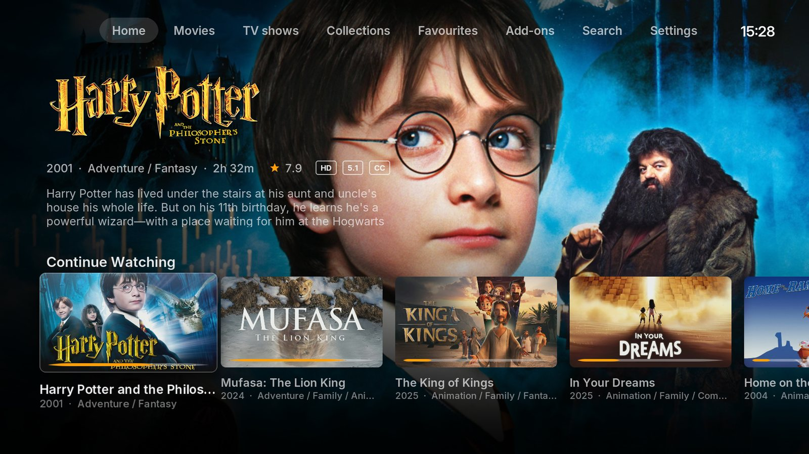
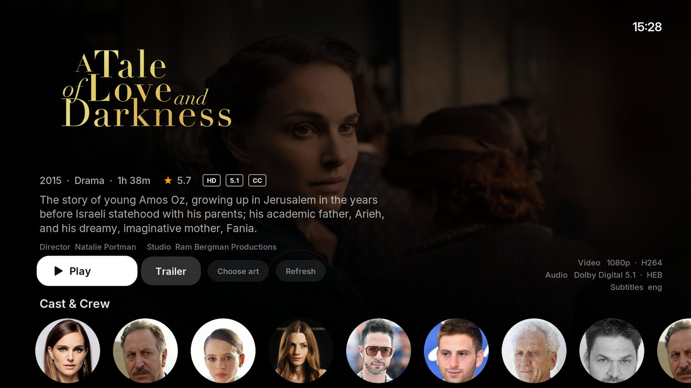
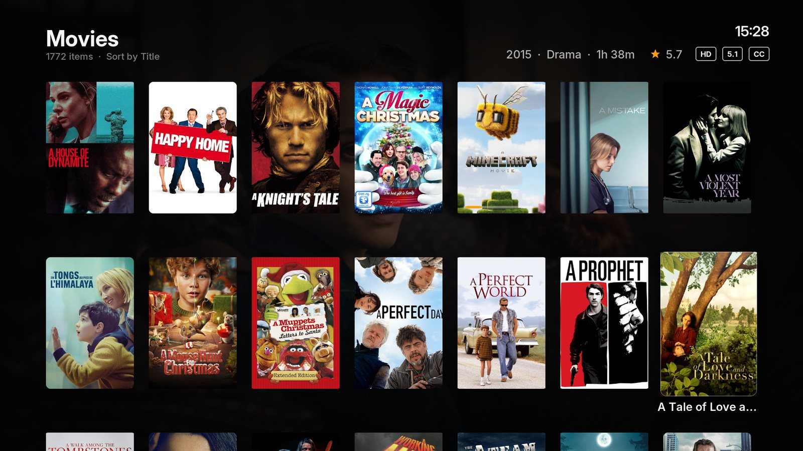
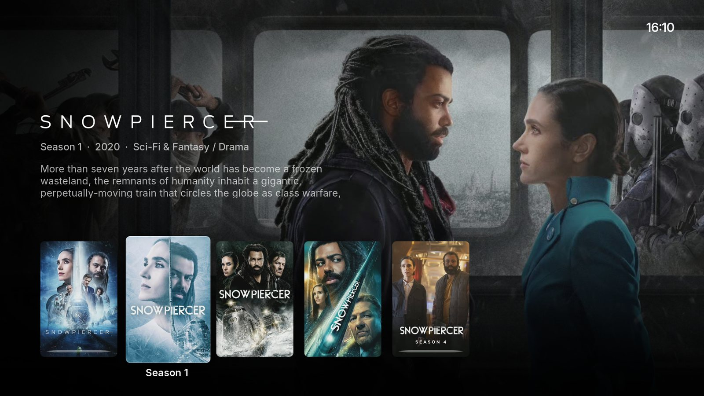
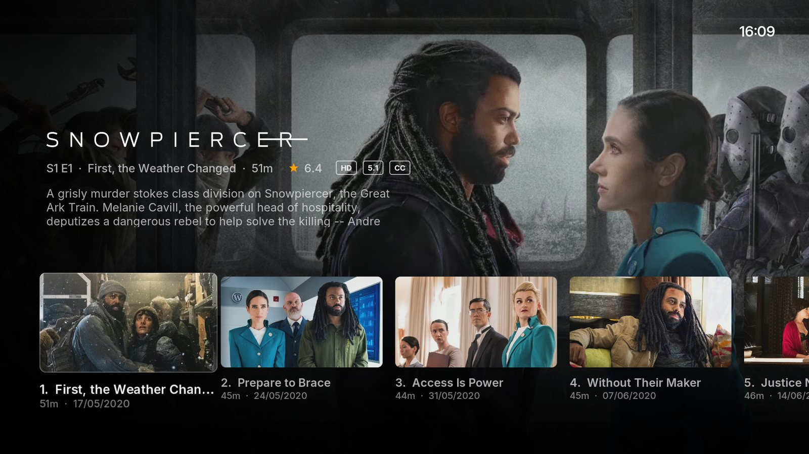
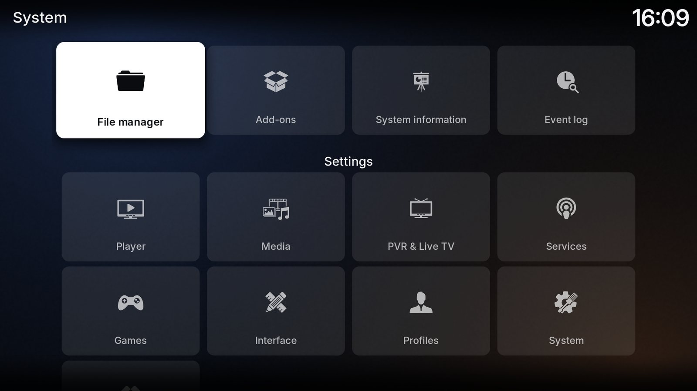
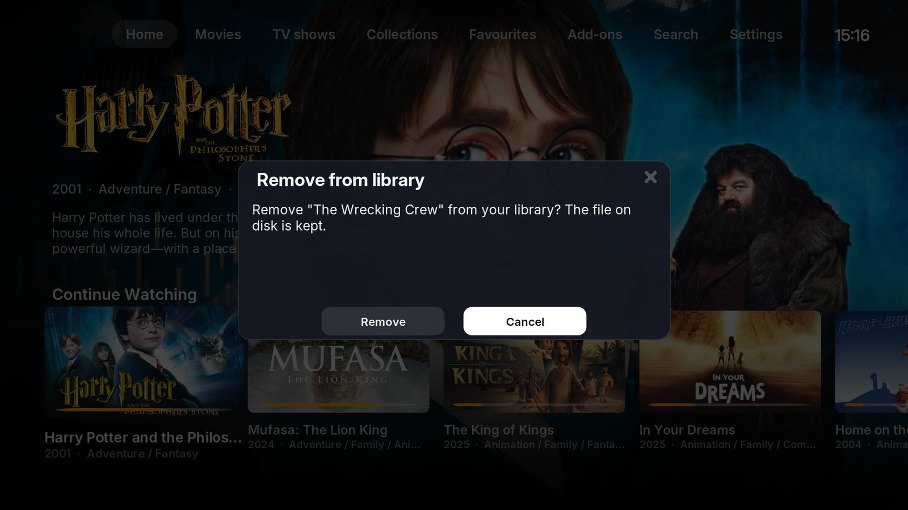

# Lumen

**A cinematic, artwork-first skin for Kodi 21 Omega, inspired by Infuse on Apple TV, and fast on a Raspberry Pi.**



Most Kodi skins look like settings menus that happen to show posters. Lumen puts
the artwork first: full-screen backdrops, clearlogos instead of plain titles,
posters that lift when focused, frosted-glass dialogs and a player overlay that
stays out of the way. It is built on Estuary, Kodi's default skin, so every
window still works. The screens you use every day were redesigned from scratch,
and the rest pick up Lumen's colours, fonts and textures.

It was designed and tuned on a Raspberry Pi 4, so it stays smooth on modest
hardware (see [Performance](#performance)).

## Screenshots

| | |
|---|---|
|  |  |
| **Detail page**: logo, metadata, tech info, cast | **Movies**: poster grid with live metadata |
|  |  |
| **Seasons**: showcase row over the show's backdrop | **Episodes**: thumbnail row with runtime and air date |
|  |  |
| **Settings**: glass tiles | **Dialogs**: rounded glass sheets, white focus |

## Features

- **Home** with a tab bar and rows that dock into place as you move down:
  Continue Watching, Up Next, Recently Added Movies, New Episodes, Discover,
  Top Rated, TV Shows and Collections. The hero above the rows shows the focused
  item's logo, year, genre, runtime, rating, quality badges and plot. Empty rows
  hide themselves. Any row can be turned off, and up to three rows of your own
  can be added from smart playlists (see [Skin settings](#skin-settings)). The
  power icon at the end of the tab bar opens Kodi's power menu (Exit, Power off,
  Reboot, depending on the device).
- **Search**: the Search tab opens the keyboard over a Lumen search page. Movies
  and shows whose title matches appear when you pause typing; confirming shows
  full rows for movies, TV shows (also by cast) and a cast & crew row. Every word
  you type must start a word of the title or original title, in any order
  ("stitch lilo" finds Lilo & Stitch; "man" finds Spider-Man and Iron Man).
- **Library views**: Posters (movies, shows, collections), Showcase (seasons,
  movies in a collection), Episodes (landscape thumbnails), Landscape grid and a
  List view with preview.
- **Quick filters**: above the Movies and TV Shows grids, a row of chips:
  All or Unwatched, Genre and Decade, and sort by Title, Date added, Year or
  Rating (newest and best first). Genre opens the genres that have titles (in
  the chosen decade): OK ticks one or several, and the grid lists titles in any
  of them. Decade opens 2020s back to "Before 1950". The chips name the picks,
  and the two combine. Kids grids have them too. Pressing the chosen sort again turns
  the order round. Up from the grid's top row reaches them. They use Kodi's own
  watched filter and sort, so the side menu agrees with them.
- **Show page**: opening a TV show gives one screen with a "Play S2 E5" button
  for the next episode to watch, season tabs and that season's episodes.
- **Detail page**: clearlogo, tagline, plot, Play/Resume with progress, Trailer,
  Versions, Extras, Collection, video/audio/subtitle details and a cast row with
  round portraits, led by the director on a film's page. The info line shows the
  age rating as a badge ("PG-13", or "FSK 12" when the library has German ones). For collections the row
  lists the movies in the set. With Kodi's *Studio Icons - White* pack installed,
  the info line ends with the studio's or the network's logo.
- **More like this**: under the cast row, a film's detail page lists more from
  its collection (in release order), more by its director (newest first) and more
  of its first genre (best rated first); a show's page lists more shows of its
  genre. Selecting a film opens its page, selecting a show opens its show page. In
  kids mode the rows list only kids titles.
- **Actor page**: select someone in a cast row to see their photo and every film
  and show of theirs in the library in one grid, newest first, with "Director"
  on the films they directed. Back from a title opened there returns to the page,
  and Back from the page to the film or show you started on.
- **Player**: thin seek bar with elapsed/remaining time, "Ends at", resolution,
  HDR, audio codec and channel badges, plus round transport buttons in the OSD.
  A sleep timer (moon button) stops playback after 15, 30, 60 or 90 minutes.
  On a live TV channel it shows the channel's name and number and "Live" instead
  of the times.
- **Next episode card**: in an episode's last 30 seconds, a card with the show's
  next episode and a countdown. Lumen starts it a moment after the episode ends
  by itself, from Kodi's resume point if it has one; **Play now** skips the rest,
  **Cancel** or Back hides the card. When the Cinémathèque app holds the next
  step (it sets the skin setting `cinemathequeholdnext`), the card shows the
  app's own line (`cinemathequenextlabel`) and starts nothing.
- **Kids mode**: a Home that shows only the films and shows tagged
  `Cinematheque Kids` in the library (the tag the Cinémathèque app writes), with
  Continue Watching, New Episodes, Recently Added, TV Shows and Discover rows,
  Movies and TV Shows grids and a search limited to those titles. Anyone can
  switch it on with the smiling-face button next to power; leaving it with the
  lock button asks for a parent's PIN. Settings, add-ons, live TV, the long-press
  menu, the cast row, trailers and the player's settings are out of reach, and
  kids mode stays on after a restart. See [Kids mode](#kids-mode).
- **Everything else**: settings, select/confirm/progress/keyboard dialogs,
  notifications, a background-task pill for library scans, Favourites and the
  skin settings page all share the same glass look.
- **Typography**: [Inter](https://rsms.me/inter/) throughout.

## Requirements

- Kodi 21 Omega (tested on 21.3)
- 16:9 display; the skin is laid out at 1920×1080
- A scraped video library with artwork. Clearlogos and landscape art (for
  example from fanart.tv) make it look its best.
- Optional: Kodi's **Studio Icons - White** image pack
  (`resource.images.studios.white`, search for "Studio Icons" in Kodi's add-on
  browser) for studio and network logos on the detail page.

## Install

1. Download `skin.lumen-<version>.zip` from the
   [latest release](https://github.com/mikedamoiseau/skin.lumen/releases/latest).
2. In Kodi: *Settings → Add-ons → Install from zip file* and pick the zip.
   You may need to allow *Unknown sources* first (*Settings → System → Add-ons*).
3. *Settings → Interface → Skin* → choose **Lumen**.

To build the zip yourself from a checkout:

```sh
git clone https://github.com/mikedamoiseau/skin.lumen.git
cd skin.lumen
git archive --format=zip -o skin.lumen.zip HEAD skin.lumen
```

### Recommended Kodi settings

Lumen is designed around these three settings. Kodi's defaults work, but feel less like Infuse.

| Setting | Value | Effect |
|---|---|---|
| Media → Videos → Default select action | **Show information** | Selecting a movie opens its detail page instead of starting playback |
| Media → Videos → Select first unwatched TV show season/episode | **On first entry** | Opening a show lands on the next episode to watch |
| Media → General → Show "parent folder" items | **Off** | No ".." tile in front of every grid |

### Skin settings

*Settings → Interface → Skin → Configure skin*

- **Animated backdrops** (off by default) slowly zoom the backdrop on Home,
  library and detail pages. It looks great, but the whole screen has to redraw
  every frame. On a Raspberry Pi 4 that roughly halves the menu frame rate, so
  it ships off.
- **Home rows**: a switch for each Home row. **Add a row…** picks a smart
  playlist and asks for the row's name; the row then shows at the end of Home
  (up to three, each with **Rename** and **Remove this row**). **Make a smart
  playlist…** opens Kodi's video playlists, where *New smart playlist…* builds
  one (for example Movies whose genre is Documentary). Kids mode keeps its own
  rows. Each device keeps its own choice.
- **Next episode card**: 30 s (default), 60 s, 90 s before an episode's end, or
  off.

## Performance

Measured on a Raspberry Pi 4 (LibreELEC 12.2, Kodi 21.3, 1080p50):

| Screen | Lumen | Estuary (same box) |
|---|---|---|
| Home, idle | no GPU work at all (nothing redraws) | – |
| Home, scrolling a row | ~39 fps | – |
| Movie grid, scrolling | ~29–35 fps | ~27–29 fps (InfoWall) |

Kodi redraws the whole screen whenever anything on it moves, so on a Pi the GPU
is the limit. Lumen keeps it light in three ways:

- Home only lays out the row you can see. The other rows are culled.
- Nothing animates continuously unless you turn on animated backdrops.
- There is no real-time blur. The "glass" is pre-rendered translucent textures.

## Development

```
skin.lumen/                  the skin; this folder is what gets installed
  xml/Includes_Lumen.xml     Lumen components: cards, hero, meta line, badges, buttons, player parts
  xml/Views_Lumen.xml        library views 500 Posters, 501 Showcase, 502 Episodes, 503 Landscape, 50 List
  xml/Home.xml               generated by tools/build_home.py, edit the script
  xml/Includes_LumenHome.xml generated by tools/build_home.py
  xml/Includes_LumenFilters.xml generated by tools/build_filters.py (the Genre / Decade picker and its paths)
  media/lumen/               generated by tools/gen_textures.py
  xml/Custom_1113-1119_*.xml kids PIN check, Home reload for the kids rows, actor page, opening a More like this
                             film, the Genre / Decade picker, the next episode card and the app's next item
  playlists/lumen_*.xsp      smart playlists behind the Discover and Top Rated rows
  playlists/kids/            kids mode's lists: only titles tagged "Cinematheque Kids"
  scripts/lumen_search.py    builds the search page's paths (Timers.xml runs it): the skin can't encode "&", "+" or "%"
tools/
  gen_textures.py            draws every Lumen texture, the Estuary texture overrides, icon and fanart
  build_home.py              Home rows (the ROWS list), their settings switches and the row-docking animations
  build_filters.py           the Genre / Decade picker: every path it opens, written out (the skin can't encode a URL)
  deploy.sh                  lint all XML, copy the skin to a Kodi box over SSH, reload the skin
  shot.sh NAME               take a screenshot on the box and copy it locally
  rpc.sh                     JSON-RPC helper
  fps.sh, navfps.sh, gpu.sh  frame-rate and GPU load sampling (gpu.sh is Raspberry Pi specific)
  log.sh                     recent warnings and errors from kodi.log
  kodi_gui.py                JSON-RPC driver shared by the checks below
  kids_check.py NAME|all     kids-mode checks on a box: rows, grids, search, PIN, blocked windows, player
  actor_check.py NAME|all    actor-page checks on a box: entry, titles, directors, Back, Play, kids mode
  morelike_check.py NAME|all detail page checks on a box: logo, More like this rows, walking and opening them, kids mode
  livetv_check.py NAME|all   live TV checks on a box: a channel plays, the player shows it, kids mode stops it
  filters_check.py NAME|all  quick-filter checks on a box: the chip row, sorts, Unwatched, genre, decade, an emptied
                             grid, kids mode
  rating_check.py NAME|all   age rating badge: every rating in the library has its badge; detail page screenshots
  homerows_check.py NAME|all Home rows checks on a box: switching rows off, adding, renaming and removing one
  search_check.py NAME|all   search checks on a box: "&", word order, word starts, odd characters, the pause while
                             typing, kids mode
  nextep_check.py NAME|all   next episode card checks on a box: the card, Cancel, the end, Play now, Stop, the app's
                             hold, the setting, Kodi's playlist, kids mode (plays unstarted episodes, puts them back)
  search_regress.py Q...     types each query into Search and prints the rows' counts
  shownext_regress.py        the show page's Play button against the next-episode rule
  mibox_install.sh           builds the working tree and installs it on an Android TV box
```

Regenerate textures and Home after changing a generator:

```sh
python3 -m venv tools/.venv && tools/.venv/bin/pip install -r tools/requirements.txt
tools/.venv/bin/python tools/gen_textures.py
python3 tools/build_home.py
python3 tools/build_filters.py
```

The helper scripts need SSH access to the Kodi box (LibreELEC: root with a key)
and JSON-RPC enabled (*Settings → Services → Control → Allow remote control via HTTP*).
Point them at your box with environment variables:

```sh
export KODI_SSH=root@<kodi-ip>        # deploy.sh, shot.sh, log.sh, gpu.sh
export KODI_HOST=<kodi-ip>:8080       # rpc.sh, fps.sh, navfps.sh
tools/deploy.sh                       # refuses while something is playing; --force to override
```

`deploy.sh` replaces `/storage/.kodi/addons/skin.lumen` on the box (the LibreELEC
path) and runs `ReloadSkin()`.

The Python checks read `KH=<kodi-ip>:8080`, plus `KODI_SSH` on LibreELEC (an
Android TV box is reached over ADB instead). They press keys on the box, so run
them while nobody is watching. `all` runs every check, then puts the box back
(kids mode off, the kids PIN as it was, nothing playing). Checks that change a Kodi setting run
only with `KIDS_OK_SETTINGS=1`, and test plays use only films without a resume
point.

### Kids mode

1. In *Configure skin*, choose **Set kids PIN** and type a PIN twice. The kids
   button (a smiling face) then appears at the end of the Home tab bar.
2. Press it to switch the TV to kids mode. A video that is playing stops and
   the play queue is cleared. The lock button in the same place leaves kids
   mode after asking for the PIN.
3. To change the PIN, choose **Remove kids PIN** (it asks for the current one),
   then set a new one. Each device keeps its own PIN.

Live TV is off in kids mode, since nothing filters channels for children: the
TV and radio windows send back to Home, and a channel, radio station or
recording started while it's on (from a phone app, say) stops.

Kids mode needs Kodi's "Show parent folder items" off (Kodi's own default is on;
the table above turns it off): a ".." item would lead from the kids lists into
the whole library, so the kids button refuses with a message while it's on.

With Kodi's "Default select action" set to **Choose**, OK does nothing in the
kids grids, because the menu it opens is closed in kids mode. Use **Show
information** (the table above) or **Play**.

Forgot the PIN? Read it from a computer on the same network over JSON-RPC:

```sh
curl -s -H 'Content-Type: application/json' http://<device>:8080/jsonrpc \
  -d '{"jsonrpc":"2.0","id":1,"method":"XBMC.GetInfoLabels","params":{"labels":["Skin.String(lumen.pin)"]}}'
```

On LibreELEC, `kodi-send --action="Skin.Reset(CinemathequeKids)"` also leaves
kids mode. Other apps can tell whether a device is in kids mode by reading
`Skin.HasSetting(CinemathequeKids)` with `XBMC.GetInfoBooleans`.

## Known limitations

- Music, Pictures, Live TV/PVR and Games keep Estuary's layouts with Lumen's styling.
- Labels added by Lumen ("Collections", "Up Next", "Back", …) are English only.
- Kodi doesn't expose Dolby Atmos, so TrueHD and DD+ are shown instead.
- Add-on folders show no backdrop on purpose, because add-on fanart is usually a promo screenshot.
- Only 1080p/16:9 layouts. Kodi scales them for 4K output.
- Kids mode is a simple lock for remote-control users, not a hard lockdown: a
  keyboard, a custom keymap or leaving Kodi from the Android TV home screen gets
  out. Anyone on the home network can read the PIN.
- The kids PIN screen asks for 4 digits, but Kodi can't check a PIN's length, so
  any number is accepted.
- Kids mode lists only titles tagged `Cinematheque Kids`. With none tagged, Home
  says so and the kids grids and rows stay empty.
- Search matches words from their start ("man" finds "Spider-Man", not "Batman").
  It runs a small Python script inside the skin, as a skin can't build a search
  path for text with "&" or "+" (Kodi then logs a warning about a script outside
  an add-on, once per search). "%" and "_" match any text, as in Kodi's own
  smart playlists. Results wait for a one-second pause in typing: Kodi's skin
  timers count whole seconds.
- The actor page lists nothing for a name with "&" or "/" in it: Kodi splits its
  library paths there. Search's cast & crew row lists films, not people: Kodi 21
  can't look people up by name for a skin.
- More like this: a title with "&", "%", "#" or "+" in its name can show up in
  its own rows, and a film whose director has one in their name may get no
  director row. The genre row knows TMDB's English genre names only: a title
  whose first genre is another one gets no genre row.
- The detail page's logo shows only for a title with one studio or network that
  the logo pack has a logo for. Kodi logs a texture error for a missing one.
- A row of your own shows posters, so it suits a playlist of films or shows.
- The quick filters are Kodi's own watched filter and sort, which Kodi keeps per
  device: Unwatched chosen in a kids grid is still on in the normal Movies grid,
  and the other way round.
- Genre knows TMDB's English genre names (what Kodi's scrapers write); a genre
  with another name is listed dimmed and can't be ticked. A decade picked after a
  genre can give an empty grid ("Nothing matches these filters."); a ticked genre
  with no titles in that decade is then listed first, dimmed, so it can be
  unticked. Each filtered grid keeps its own sort.
- In kids mode, Genre and Decade open the films through Kodi's list for video
  versions, the one film list Kodi doesn't group into collections (kids grids
  never show collections). That list also holds a film's extra versions, so a
  film with two versions in Kodi would show twice there. This relies on Kodi 21;
  `filters_check.py gd_kids` notices if a later Kodi changes it.
- The next episode card takes the remote while it shows, so the arrows don't
  seek and OK doesn't open the player's menu; Play/Pause and Stop still work, and
  Back hides the card. The next episode starts a second or two after the end:
  Kodi has to report the end first. A stop by hand in the last two seconds also
  starts it. Specials (season 0) get no card.
- The Up Next add-on (`service.upnext`) does the same job its own way: it queues
  the next episode in Kodi's playlist, so Lumen's card stays away and the
  Cinémathèque app can't hold the next step. Turn it off to use Lumen's card.
- Kodi's scrapers store US age ratings, and many titles have none. Lumen shows
  whatever the library holds; the Cinémathèque app can fill it with German ones.

## Credits & license

- Built on [Estuary](https://github.com/xbmc/xbmc/tree/master/addons/skin.estuary) by phil65 and Team Kodi.
- [Inter](https://rsms.me/inter/) by Rasmus Andersson.
- Inspired by [Infuse](https://firecore.com/infuse). Lumen is not affiliated
  with Firecore or Apple.

Code is licensed under the [GNU GPL v2.0](LICENSE), like Estuary. Artwork
derived from Estuary is under CC BY-SA 4.0, and the fonts are under the SIL Open
Font License 1.1. See [`skin.lumen/LICENSE.txt`](skin.lumen/LICENSE.txt).
The movie and TV artwork in the screenshots comes from TMDB and fanart.tv and
belongs to its respective owners.
